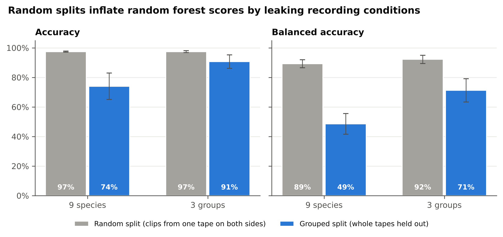
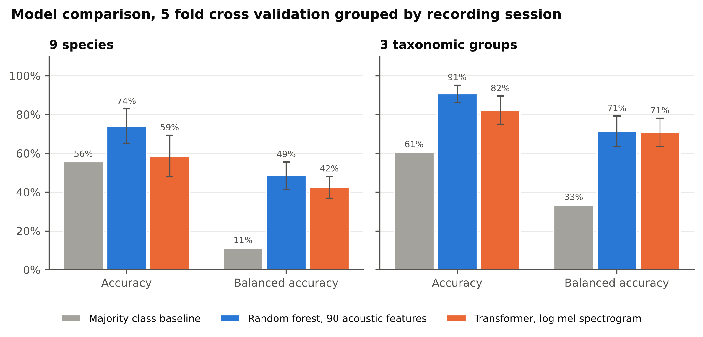

# Marine mammal call classification with random forest and transformer models on 4,761 Watkins recordings

[](https://doi.org/10.5281/zenodo.22859088)

**Preprint:** Frey, E. (2026). Recording session leakage inflates accuracy in marine mammal call classification. EcoEvoRxiv. [doi.org/10.32942/X2P68X](https://doi.org/10.32942/X2P68X)

**Write up:** [Can AI tell a narwhal from a bowhead whale by sound alone?](https://simplyecologist.com/ai-marine-mammal-call-classification/), a plain language walkthrough of the method and the results.

This project classifies nine Arctic and subarctic marine mammal species, and
three taxonomic groups, from 4,761 recordings of the Watkins Marine Mammal
Sound Database. It compares a random forest on 90 hand crafted acoustic
features with a small transformer trained from scratch on log mel
spectrograms. Every model is evaluated with 5 fold cross validation **grouped
by recording session**, so no tape ever contributes clips to both the
training and the test side. The same random forests are then rescored with
ordinary random splits to measure how much that leakage inflates accuracy.

## Key findings

1. **Random splits overstate performance.** With clips from the same tape on
   both sides of the split, the random forest reaches 97% accuracy on both
   tasks. Holding out whole tapes drops species accuracy to 74% and balanced
   accuracy from 89% to 49%. The model partly learns the recording (tape,
   equipment, background noise) rather than the animal.
2. **Taxonomic group is learnable across tapes.** Baleen whales, toothed
   whales and pinnipeds are separated with 91% accuracy (71% balanced) on
   unseen tapes, against a 61% majority class baseline.
3. **A transformer from scratch matches the random forest on balanced
   accuracy for groups** (71% vs 71%) but not on species
   (42% vs 49%, and only 59% accuracy against a 56% majority baseline).
   With 46 to 2,647 clips per species, hand crafted features remain the stronger choice at this data size.
4. **Rare species collapse into killer whale.** On unseen tapes the random
   forest keeps killer whale (F1 0.93) and bowhead whale (0.74), but narwhal
   (0.02) and ringed seal (0.00), each recorded on only 5 or 6 tapes, are
   mostly predicted as killer whale. Their high random split scores (0.91 and
   0.73) came almost entirely from recognising the tape.
5. **No unsupervised structure.** KMeans on the PCA of the acoustic features
   does not recover species or groups (adjusted Rand index at or below zero), so the
   signal is only accessible to supervised models.

## Data

All recordings of nine species from the [Watkins Marine Mammal Sound
Database](https://cis.whoi.edu/science/B/whalesounds/index.cfm) (Woods Hole
Oceanographic Institution; Sayigh et al. 2016), recorded between 1949 and
1997, fetched clip by clip from the public [Internet Archive
mirror](https://archive.org/details/watkins-marine-mammal-sound-database-full-cuts).
Six species are Arctic or subarctic residents; killer whale and humpback
whale are wider ranging comparison species. See `LICENSE_DATA.md` for
attribution and reuse terms.

| Species | Scientific name | Group | Clips | Tapes |
|---|---|---|---:|---:|
| Humpback whale | *Megaptera novaeangliae* | Baleen whale | 604 | 14 |
| Bowhead whale | *Balaena mysticetus* | Baleen whale | 406 | 6 |
| North Atlantic right whale | *Eubalaena glacialis* | Baleen whale | 486 | 22 |
| Killer whale | *Orcinus orca* | Toothed whale | 2,647 | 65 |
| Narwhal | *Monodon monoceros* | Toothed whale | 86 | 6 |
| Beluga | *Delphinapterus leucas* | Toothed whale | 150 | 12 |
| Bearded seal | *Erignathus barbatus* | Pinniped | 63 | 7 |
| Ringed seal | *Pusa hispida* | Pinniped | 46 | 5 |
| Walrus | *Odobenus rosmarus* | Pinniped | 273 | 11 |
| **Total** | | | **4,761** | **148** |

A recording session is defined from the Watkins file name, whose first five
characters encode the year and tape number. The audio is not committed here;
`data_raw_manifest.csv` lists every clip and `download_clips.py` fetches
exactly those files.

## Methods

1. **Harmonisation.** Every clip is mixed to mono and resampled to
   22,050 Hz (the originals span many sample rates).
2. **Features.** 90 classical acoustic features per clip: 20 MFCCs and their
   deltas (mean and SD over time) plus spectral centroid, bandwidth, rolloff,
   zero crossing rate and RMS loudness (mean and SD). Separately, a
   64 x 128 log mel spectrogram (first ~1.5 s) per clip.
3. **Unsupervised check.** Standardised features, PCA to 10 components,
   KMeans with k chosen by silhouette score, adjusted Rand index against the
   labels.
4. **Random forest.** 400 trees, balanced class weights, scored with 5 fold
   `StratifiedGroupKFold` (grouped by tape) and with 5 fold
   `StratifiedKFold` (random).
5. **Transformer.** A vision style transformer trained from scratch: 8 x 8
   spectrogram patches, 64 dimensional embeddings, 2 encoder layers, 4
   attention heads, dropout 0.3, class weighted cross entropy, AdamW with a
   cosine schedule for 25 epochs, SpecAugment style frequency and time masks.
   Same grouped folds as the random forest.
6. **Metrics.** Accuracy, balanced accuracy (mean per class recall, the fair
   metric here because killer whales are 56% of clips) and macro F1, reported
   as mean and SD over the 5 folds.

## Results

5 fold cross validation, mean (SD) over folds. Grouped = whole tapes held out.

| Task | Model | CV | Accuracy | Balanced accuracy | Macro F1 |
|---|---|---|---|---|---|
| 9 species | Majority class |  | 56% | 11% |  |
| 9 species | Random forest | Random | 97% (0%) | 89% (3%) | 0.92 |
| 9 species | Random forest | **Grouped** | 74% (9%) | 49% (7%) | 0.43 |
| 9 species | Transformer | **Grouped** | 59% (11%) | 42% (6%) | 0.35 |
| 9 species | BirdNET v2.4 embeddings + logistic regression | Random | 98% (0%) | 95% (1%) | 0.95 |
| 9 species | BirdNET v2.4 embeddings + logistic regression | **Grouped** | 80% (4%) | 66% (11%) | 0.51 |
| 9 species | Perch 2.0 embeddings + logistic regression | Random | 98% (0%) | 96% (1%) | 0.95 |
| 9 species | Perch 2.0 embeddings + logistic regression | **Grouped** | 79% (4%) | 69% (7%) | 0.56 |
| 3 groups | Majority class |  | 61% | 33% |  |
| 3 groups | Random forest | Random | 97% (1%) | 92% (3%) | 0.94 |
| 3 groups | Random forest | **Grouped** | 91% (5%) | 71% (8%) | 0.70 |
| 3 groups | Transformer | **Grouped** | 82% (7%) | 71% (7%) | 0.68 |
| 3 groups | BirdNET v2.4 embeddings + logistic regression | Random | 99% (0%) | 97% (2%) | 0.97 |
| 3 groups | BirdNET v2.4 embeddings + logistic regression | **Grouped** | 90% (5%) | 81% (8%) | 0.77 |
| 3 groups | Perch 2.0 embeddings + logistic regression | Random | 99% (0%) | 98% (1%) | 0.98 |
| 3 groups | Perch 2.0 embeddings + logistic regression | **Grouped** | 91% (4%) | 83% (7%) | 0.78 |





All figures are in `figures/` (the `paper_*` set is publication formatted at
300 dpi) and every number above is in `outputs/model_summary.csv` and
`outputs/pretrained_summary.csv`, with per species F1 scores in
`outputs/rf_per_species_f1.csv`.

Pretrained embeddings did best on unseen tapes, but random splits still
inflated their species balanced accuracy by 28 (BirdNET) and 26 (Perch 2.0)
points, so leakage is not a problem of weak models only.

## Limitations

- Species are very unevenly represented (46 to 2,647 clips, 5 to 65 tapes),
  so grouped scores for the rarest species rest on few tapes and vary
  strongly between folds.
- Grouping by tape removes the most obvious leakage, but tapes from the same
  expedition or year may still share conditions.
- Labels come from the database's species folders and were not
  independently reverified.
- The transformer sees only the first ~1.5 s of each clip and is trained
  from scratch. The pretrained models (BirdNET, Perch 2.0) use the first 30 s
  and were trained mainly on bird and other terrestrial sounds; a model
  trained on marine mammals may describe very low frequency calls and very
  high frequency clicks better.
- No location, season or behavioural context is used, only the audio.

## Reproducing this

```
pip install -r requirements.txt
python download_clips.py          # ~710 MB, data_raw/<species>/<year>/<file>.wav
python extract_features.py        # feat/<species>.npz
EPOCHS=25 python analysis.py      # outputs/ and figures/, about 75 min on 2 CPU cores
python make_figures.py            # figures/paper_*.png
```

Pretrained embeddings (v1.2.0):

```
pip install birdnetlib ai-edge-litert "tensorflow-cpu~=2.20.0"
python pretrained/embed_birdnet.py                     # feat/birdnet_embeddings.npz
PERCH_DIR=path/to/perch_v2_cpu python pretrained/embed_perch2.py   # feat/perch2_embeddings.npz
python pretrained/evaluate_embeddings.py perch2 lr species   # also: birdnet, group, rf
```

Perch 2.0 (perch_v2_cpu, Apache 2.0) is downloaded from
https://www.kaggle.com/models/google/bird-vocalization-classifier; the
BirdNET v2.4 model file ships with birdnetlib. On two CPU cores the BirdNET
embeddings take about 8 minutes and the Perch 2.0 embeddings about 90 minutes.

## Repository layout

```
data_raw_manifest.csv    species, year and file name of all 4,761 clips
download_clips.py        fetches the clips from the Internet Archive mirror
extract_features.py      resampling, 90 acoustic features, log mel spectrograms
analysis.py              clustering, random forests, baselines, transformer, grouped and random CV
make_figures.py          publication figures and per species scores
common.py                shared constants, feature loading and cross validation folds
pretrained/               BirdNET and Perch 2.0 embeddings and their evaluation
figures/  outputs/       all generated figures and result tables
LICENSE                  MIT, for the code
LICENSE_DATA.md          data attribution; CC BY 4.0 for derived outputs
```

## Changes since v1.0.0

v1.0.0 used a 225 clip subset (25 per species) with a single held out split
for the transformer. v1.1.0 uses all 4,761 clips for the same nine species,
cross validates every model with folds grouped by recording session, adds the
random split comparison, baselines and balanced accuracy, and replaces the
download endpoint used by v1.0.0, which no longer resolves.

## Changes since v1.1.0

v1.2.0 adds two pretrained bioacoustic models, BirdNET v2.4 and Perch 2.0.
Their embeddings are classified with a logistic regression and evaluated
with the same grouped and random folds as the other models
(`outputs/pretrained_summary.csv`).

## Changes since v1.2.0

v1.2.1 reorganises the code without changing any result: every script now
runs through a `main()` function, shared loading and fold logic lives in
`common.py`, and functions take their data as arguments instead of using
global variables. Rerunning the old and new code on the same input gives
byte identical outputs and figures.

## How to cite

To cite the study, please use the preprint:

> Frey, E. (2026). Recording session leakage inflates accuracy in marine mammal call classification. EcoEvoRxiv. https://doi.org/10.32942/X2P68X

To cite the code and data:

> Frey, E. (2026). Marine mammal call classification with random forest and transformer models on 4,761 Watkins recordings (v1.2.0). Zenodo. https://doi.org/10.5281/zenodo.22859088

The concept DOI above always resolves to the latest version. Please also cite
the data source:

> Sayigh, L., Daher, M. A., Allen, J., Gordon, H., Joyce, K., Stuhlmann, C., and Tyack, P. (2016). The Watkins Marine Mammal Sound Database: An online, freely accessible resource. Proceedings of Meetings on Acoustics, 27, 040013.
